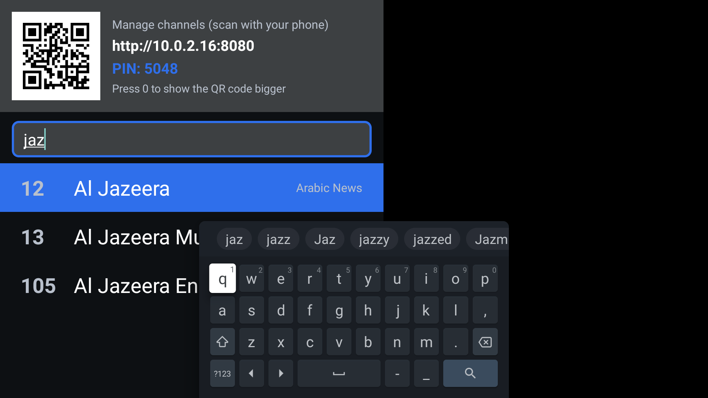

# Parents TV

An Android TV app that behaves like a plain cable box. It opens by itself when the TV turns on,
plays the last channel, and is driven only with the remote: channel up/down, numbers, volume.
Channels are managed from a phone or PC browser on the same home network.

Built for an Android 9 MediaTek/Cvte smart TV in Morocco, but it runs on any Android TV
(Android 7.0 or newer).



## Features

- **Full-screen live TV** from HLS / M3U links, with automatic fallback to backup links and
  automatic reconnecting. Always picks the highest quality the TV can decode.
- **Remote only.** CH+/CH- or ▲/▼ change channel, digits jump to a number, ◀/▶ change the volume,
  OK opens the channel list, Back never leaves the app.
- **Search** in the channel list (▲ to the search box, OK to type) by name or category.
- **Opens by itself** at power-on and after standby, on the last channel watched. A switch on
  the TV and on the web page turns this on or off; a new TV needs a
  [one-time setup](docs/NEW_TV_SETUP.md#5-turn-on-auto-start-one-time-setup) (30 s with the remote).
- **132 free channels** out of the box, grouped: Morocco first, then Arabic News, Documentary,
  Movies, Series, Entertainment, International News, Sports, Music, Kids, Culture, Religious.
  Nothing 18+.
- **Web page on the TV** (`http://<tv-ip>:8080`, PIN `5048`), reachable by scanning the QR code
  shown at the top of the channel list:
  - **Channels** tab: browse by category, search, tap to switch the TV, **★ favorites** (one tap
    adds whatever is playing right now).
  - **Manage** tab: the auto-start switch, add / edit / delete / reorder channels, test links,
    import JSON or M3U files (duplicates are merged, never doubled), export a backup, reset to
    defaults.

## Remote control

| Key | Action |
|---|---|
| CH+ / ▲ | Next channel |
| CH- / ▼ | Previous channel |
| 0-9 | Go to channel number (switches after 2 s, or at once when unambiguous) |
| ◀ / ▶ | Volume down / up, with an on-screen bar |
| Mute | Mute (the TV shows its own icon) |
| OK | Channel list with search and the management QR code |
| 0 (while the list is open) | Show the QR code large, in the middle of the screen |
| ▲ from the search box, then OK | Turn "Open at power-on" on or off |
| Info / Menu | Management address and PIN |
| Back | Close whatever is open; never leaves the app |

## Install on a TV

The ready-made APK is in [`apk/ParentsTV.apk`](apk/ParentsTV.apk).

```
adb connect <tv-ip>:5555
adb install -r apk/ParentsTV.apk
adb shell settings put secure enabled_accessibility_services com.osama.parentstv/com.osama.parentstv.autostart.AutoStartService
adb shell settings put secure accessibility_enabled 1
```

The last two lines are the one-time auto-start setup; it can also be done with the remote, see
the guide.

Full step-by-step guide for any TV brand: **[docs/NEW_TV_SETUP.md](docs/NEW_TV_SETUP.md)**.

## Documentation

| Document | What it covers |
|---|---|
| [docs/NEW_TV_SETUP.md](docs/NEW_TV_SETUP.md) | Setting up a new TV of any brand: developer mode, ADB, install, auto-start, checks |
| [docs/TV_ADB_AND_DEBLOAT.md](docs/TV_ADB_AND_DEBLOAT.md) | Finding and connecting to a TV on the network, every debug command used, removing bloatware safely, recovering a TV that will not boot |
| [docs/DEVELOPMENT.md](docs/DEVELOPMENT.md) | Building, tests, the TV emulator, the channel tools, the web API, how the code is organised |
| [docs/PLAN.md](docs/PLAN.md) | The original design plan |

## Repository layout

```
apk/ParentsTV.apk            ready-to-install APK (kept in git on purpose)
app/                         Android app (Kotlin, Media3 ExoPlayer, no Leanback)
  src/main/assets/default_channels.json   the channels the app ships with
  src/main/assets/admin/index.html        the web management page
tools/channel_list.ps1       which channels to ship, their category and order
tools/build_channels.ps1     rebuilds default_channels.json from public lists and checks every link
tools/check_channels.ps1     plays every channel on a TV and reports picture / sound
backups/                     channel lists exported from the TV
build.ps1                    tests + APKs (+ install with -Install)
docs/                        documentation
```

## Channel sources and limits

Streams come from the public [iptv-org](https://github.com/iptv-org/iptv) and
[Free-TV](https://github.com/Free-TV/IPTV) lists of free, legally available channels. Free streams
change often; run `tools\build_channels.ps1` to refresh the list, or fix a single channel from the
Manage tab.

Not included, on purpose:

- **SNRT channels** (Al Aoula, Tamazight, Athaqafia, Assadissa, Laayoune): SNRT serves them only
  through its own player with signed access tokens. Watch them on [snrtlive.ma](https://snrtlive.ma)
  or on the TV's satellite tuner.
- **Paid networks** (beIN, OSN, Canal+, Cinemax, ...) and channels with no legitimate free stream
  (Nat Geo Abu Dhabi, Zee Alwan).

## Security note

The management page is only reachable from the home network and every change needs the PIN. The
PIN is a fixed default (`5048`, in `Settings.kt`); change it there if the repository is public and
the TV sits on a shared network.
